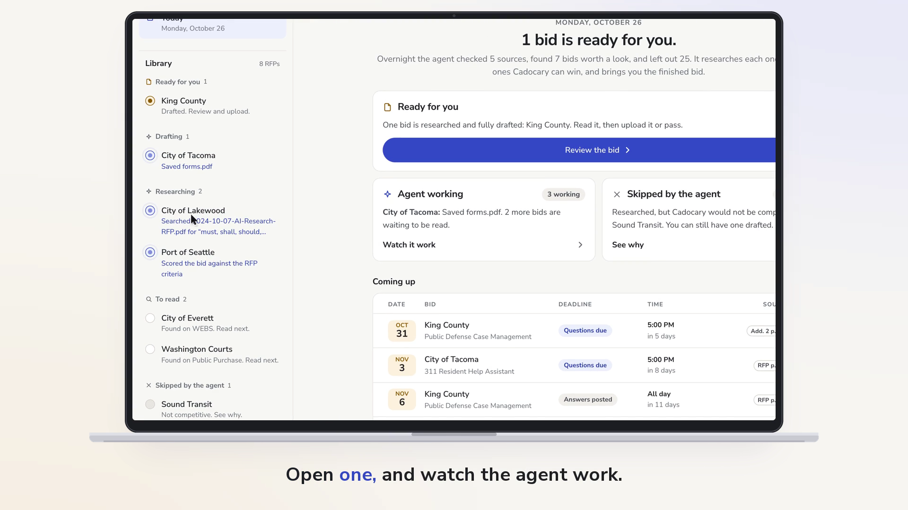
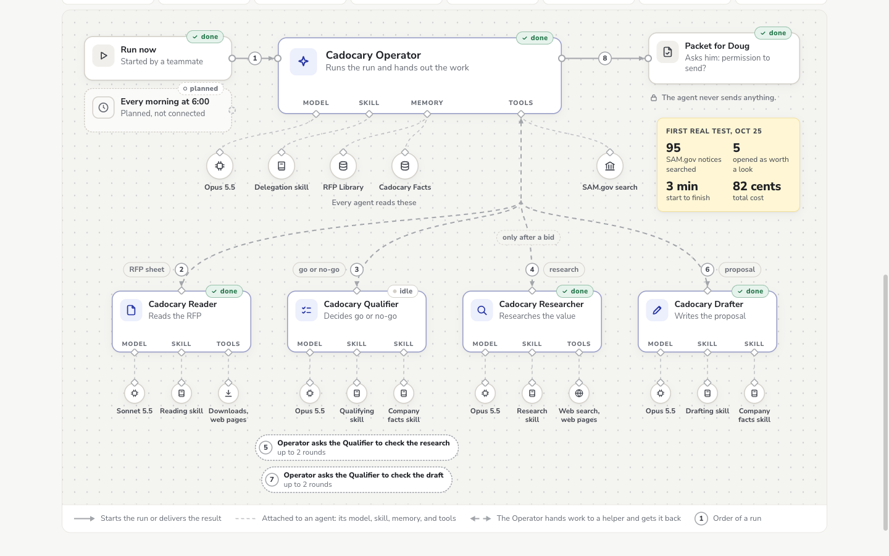

# Cadocary Bids

An AI bid agent for a small government software vendor. Overnight, it finds RFPs, reads them, decides which ones the company can win, researches what they're worth, and drafts the proposal. The owner reads one finished bid and decides whether to send it.



## The problem

Doug owns Cadocary LLC, a small Washington software company that builds tools for public defenders and courts. He wins work by bidding on government contracts. Every bid means finding the RFP, reading it page by page, working out what it's worth, and writing the proposal. That's days per bid, so most go unanswered.

What he asked for: "I want artificial intelligence, not artificial asking if I'm right." And the one message he wants: "You are a competitive applicant, here is your application, and this is how much money I expect it to be worth. Permission to send?"

## What it does

- **Finds contracts.** It searches SAM.gov for Cadocary's codes and saves every open notice in an RFP library on Anthropic.
- **Reads every RFP and attachment.** It writes a sheet of every requirement and deadline, each with its page and the exact quote.
- **Decides go or no-go** against Doug's rules ($1 million to $5 million, no military work, at least 7 days to respond) and Cadocary's approved facts.
- **Researches** what the contract is worth and who won similar ones, with a source for every number. It says "not found" rather than guess.
- **Drafts the proposal** only from Cadocary's facts, and hands Doug one packet: why the bid is competitive, what it's worth, the draft, and every call it made. Nothing is sent without him.

## How it works

Five Claude agents run on [Anthropic Managed Agents](https://platform.claude.com/docs/en/managed-agents/overview). An Operator (Opus 5.5) runs each RFP and hands the work to four helpers, each with its own skill: a Reader on Sonnet 5.5, then a Qualifier, a Researcher, and a Drafter on Opus 5.5. Code does every search, download, and save, and the agents only make judgment calls. None of them can send anything.



More: [`docs/context.md`](docs/context.md) has the full story and decisions, and [`agent/README.md`](agent/README.md) has the agents, skills, and storage.

## Try it

- **The app:** open [`prototype/click-through.html`](prototype/click-through.html) with a double-click. It is a clickable version with sample bids, plus one real RFP (City of Lakewood).
- **The agents:** with the keys in place (see [`agent/README.md`](agent/README.md)):
  ```bash
  python3 agent/library.py sync                          # save every open SAM.gov notice
  python3 agent/run.py <notice_id> --steps all           # run the agents on one RFP
  ```

## What is real and what is not yet

- **Real and tested:**
  - the five agents and their skills
  - the hosted SAM.gov search
  - the RFP library
  - the run launcher
  - every step on real federal RFPs
- **First full draft:** for a Transportation Department RFI, written in 18 minutes for $6.38. It is saved in the RFP library.
  - The research estimated about $650,000, with low confidence, so the agent recommended passing, under Doug's $1 million floor.
  - The draft invents no references, staff, or certifications. It marks 9 items for Doug to fill in.
- **The online app:** the Agent page shows real runs live.
- **Sample data:** the bids in the app, except the City of Lakewood RFP.
- **Not built yet:**
  - Washington sources (WEBS, Public Purchase)
  - the 6 AM schedule
  - watching for the buyer's reply
  - code checks on every citation

## Team

TEAM_PLACEHOLDER

Built at the Seattle AI Week Claude Impact Lab, October 25, 2026.

## SAM.gov sourcing scripts

An agent that finds the federal contract opportunities a small business can actually respond to.
Each day it pulls SAM.gov for your NAICS codes, throws out everything already awarded, expired, or
set aside for someone else, and ranks what's left against what your business does.

## Quick start

You need Python 3.9+ (standard library only) and [Claude Code](https://claude.com/claude-code).

```bash
bin/sam-research.sh                      # or, inside Claude Code: /sam-research
open data/report.md
```

`profile.json` holds your NAICS codes, optional PSC codes, the set-asides you qualify for, and a
plain-language list of capabilities the agent scores against. It is the only file you edit. The one
in this repo is Cadocary's, built from its public SAM.gov registration; copy
`profile.example.json` over it to point the pipeline at a different business.

No Claude Code? `bin/sam-research.sh --no-agent` does the pull and filtering and leaves an unranked
`data/open_opportunities.csv`.

## What gets filtered out, and where

Most of what SAM.gov calls "active" is not something you can bid on. On a four-code software
profile, 2,298 active notices held 112 open for response. The rest were award notices, expired
solicitations, and justifications.

| Removed | How |
|---|---|
| Award notices, justifications, surplus sales | Never requested: the search asks only for responsive notice types |
| Deadlines already passed | Never requested: the search asks for `response_date` from now |
| Solicitations still listed as active after an award was posted | Each notice's related notices are checked for an award |
| Set-asides you aren't eligible for | `set_aside_eligibility` in `profile.json` |
| Cancelled notices | Filter |
| Notices you already reviewed | Shown, but only new or amended notices are re-scored and marked **NEW** |

Because the filtering happens in the search, a run fetches detail for ~100 notices, not ~2,500, and
finishes in about ten seconds before scoring.

RFIs have no notice type of their own on SAM.gov. Agencies post them as Sources Sought or Special
Notices, so both are kept and labelled "market research". Answering one is how a small business
gets a later solicitation set aside for it.

## How it runs

```
profile.json
   │
   ▼
scripts/fetch_sam_opportunities.py   SAM search (server-side filtered) + detail + award check
   │  data/opportunities.json
   ▼
scripts/filter_open.py               awarded / set-aside / cancelled / deadline; marks NEW
   │  data/open_opportunities.json
   ▼
scripts/scores.py pending            only notices not yet scored, or amended since
   │
   ▼
sam-researcher agent                 judges fit against capabilities → data/new_scores.json
   │  scripts/scores.py merge
   ▼
scripts/render_report.py             validates scores, writes data/ranked.json + data/report.md
```

The agent (`.claude/agents/sam-researcher.md`) only makes the judgment call. Every SAM.gov request
and every output file comes from a script, so the result doesn't depend on how the model phrased
things. `render_report.py` refuses to publish if any open notice is unscored or a score is
malformed. `.claude/settings.json` limits the agent to running those four scripts and writing its
scores file.

The SAM.gov endpoints are the public ones sam.gov's own search page uses, so there's no API key. They
answer `406` unless the request sends `Accept: application/hal+json`.

### Schedule it

```
# crontab -e — weekdays at 7:00
0 7 * * 1-5  /path/to/repo/bin/sam-research.sh >> /path/to/repo/data/logs/cron.log 2>&1
```

Runs headless with `--permission-mode dontAsk`, so a disallowed action fails instead of hanging.
`SAM_RESEARCH_BUDGET_USD` caps model spend per run (default $2). On macOS you get a notification
when there's something new.

### Outputs

| File | For |
|---|---|
| `data/report.md` | You: pursue / consider / skip, best fit first, with deadline, agency, set-aside, contact |
| `data/ranked.json` | Anything you build on top: the same result, as `groups.{pursue,consider,skip}[]` |
| `data/open_opportunities.csv` | A spreadsheet of every open notice, unranked |

`data/` is gitignored. Solicitations turn over daily, so regenerate the data instead of committing
it.

### Script options

- `fetch_sam_opportunities.py --include-no-deadline` also pulls notices with no response date
- `fetch_sam_opportunities.py --all-notices --include-inactive` turns off the server-side filters,
  for past-award and competitor research (slow)
- `filter_open.py --days 30` limits to deadlines in the next 30 days
- `filter_open.py --keep-awarded` / `--ignore-set-aside` turn off those two filters

## Tests

The pipeline itself is stdlib-only, so the tests are the only thing that needs an install. One
virtualenv keeps it off your system Python:

```bash
python3 -m venv .venv && .venv/bin/python -m pip install -r requirements-dev.txt
.venv/bin/python -m pytest -q tests/
```

Offline; nothing calls SAM.gov. 44 tests, under a second.
